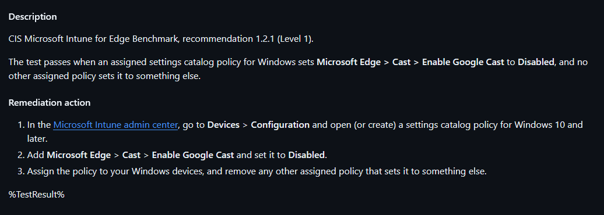
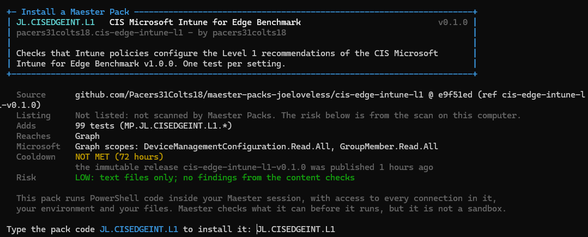
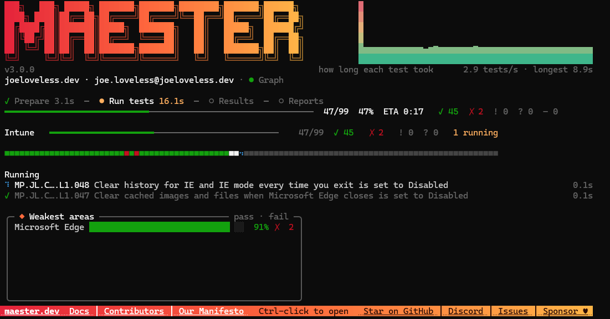
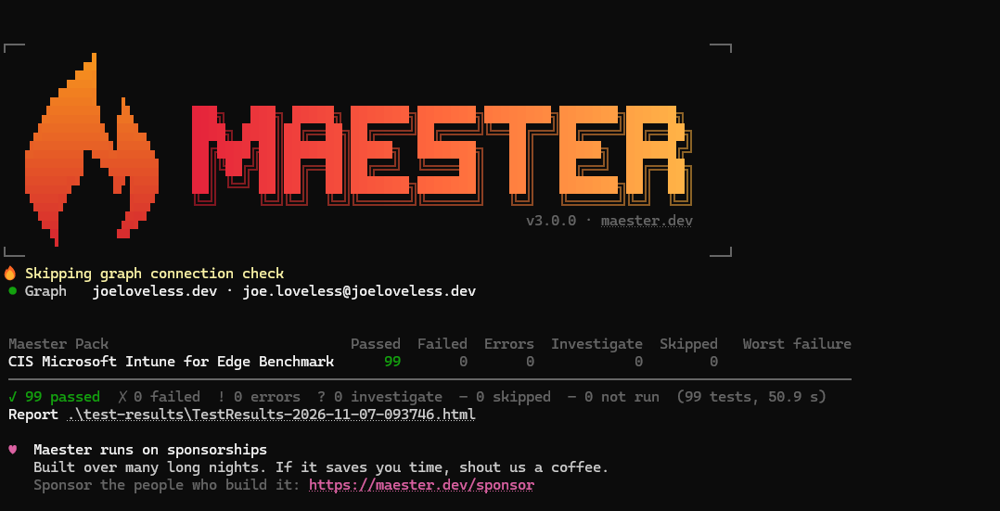
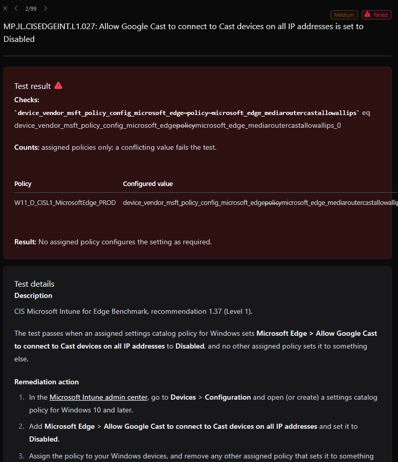

{/* truncate */}

Happy November everyone. I hope everyone had a great Halloween. Our kids are no longer at trick or treating age, but we still had a great time. I took my daughter to a couple of haunted houses. One of them we've gone to the last couple of years in New Ulm, Minnesota and that one is always a top notch haunted house. We tried to go to another one in Winnebago with my son. Let's just say he's not the haunted house type and backed out while standing in line. Unfortunately, this haunted house was pretty weak on the scare aspect. The haunted house was an old school building, so way too big and you could see the hiding spots coming a mile away. We still had a good time though. Halloween is one of my favorite holidays. 

Now it's on to Thanksgiving and Christmas. I'm not sure what our plans are yet for those holidays. We're undecided if we are going to travel down to Indiana to see family or not. I think I'd much rather take an actual vacation somewhere else than to travel to good ole Indiana. The car ride from Minnesota > Iowa > Illinois > Indiana is especially exciting this time of year with all the fields having been plowed. Makes for a really exciting trip! /s

I've started to look at [Maester](https://maester.dev) a little bit, more out of my own personal curiosity, but something that I think could bring a lot of value to where I work at. Maester is an open-source way to scan your M365 environment for known issues from the community. Members make Maester tests based off Pester to define what should be a pass/fail. This is a fairly new project, probably in the last year or so. From what I've seen, it started as more of an Identity side of the house project, but has quickly grown to include some Intune, some AD, and some other areas.

## What's coming?

In version 3 (yet to be released), there is the introduction of [Maester Packs](https://maester.dev/docs/packs). Maester Packs allow you to publish a pack from a GitHub repository to allow for optional scans to be downloaded and ran.

## What peeked my interest?

In my day to day, I've always wondered if we would truly know if something changed without a ticket coming our way. Someone could make a change to a setting that wasn't expected and we wouldn't know about it until the next time there is a review of policies. I work on a team of 8 engineers. Shit happens.

Rather than constantly running reports manually with spreadsheets everywhere, why not run this with Maester and have it done automatically? All though this post won't dive into that, Maester gives you that ability to [automate](https://maester.dev/docs/monitoring) with nearly every possible way.

## Requirements

Maester has it's own requirements. Mainly you need the following:

- Maester version 3 (for the packs)

```powershell
Install-Module Maester -AllowPrerelease -Scope CurrentUser
```
- PowerShell 7.4 or later
- If running built-in tests, you need the proper Graph API permissions (documented in each test)

Pack requirements:

- **Graph API permissions**
  - DeviceManagementConfiguration.Read.All
  - GroupMember.Read.All

There are no configuration changes happening, just reads.

Myself, I have a **delegated app permission** with just the necessary permissions. This allows me to connect and run the scans manually. When I go to set this up to run automatic scans, we'll need **application permissions** for the App Registration.

## What packs are there?

All the available packs for Maester can be found here: https://packs.maester.cloud/

I've built the following packs, all are designed to scan against CIS Benchmarks designed for Microsoft Intune.

- CIS Microsoft Intune for Windows 11 v5.0.0 (Level 1)
  - 307 individual tests
- CIS Microsoft Intune for Windows 11 v5.0.0 (Bitlocker)
  - 28 individual tests
- CIS Microsoft Intune for Edge Benchmark (Level 1)
  - 99 individual tests
- CIS Apple MacOS 26 Tahoe Intune Benchmark (Level 1)
  - 90 individual tests
- CIS Apple iOS 26 and iPadOS26 Intune Benchmark (Level 1)
  - 55 individual tests
-  CIS Microsoft Intune for Microsoft Defender Antivirus Benchmark (Level 1)
   -  52 individual tests

My goal is to add other scans to cover other frameworks, and to keep these updated with every revision of the benchmark. I'm also planning on adding the Office benchmark, and will probably begin work on that next week.

## How do you build these?

All our built manually, well kinda. 

1. Benchmarks are downloaded from [CIS](https://cissecurity.org)
2. Benchmarks are created in Microsoft Intune.

From there, I created an export command that exports the policy to a CSV file. [Example for Microsoft Edge](./edge.csv)

- Recommendation and Severity I fill in myself. The CSV allows me to manipulate the data, for example if a test should be "Setting should be this or greater", I can set the CSV to the lowest acceptable value and add an operator onto it.

Full disclosure, once I got to the annoying edge cases in Intune this is where Claude came into help me. Nothing about the Settings Catalog has a great structure to it, so finding the holes in my logic was very valuable. I was then also able to build on Compliance Policies and Device Configurations into the logic.

Claude is great for refining the initial creation, poking holes in it, and helping me get it to the next level.

- Next, I run a process to create a new pack. Example below:

```powershell
New-JLMaesterPack -Folder cis-edge-intune-l1 -Code JL.CISEDGEINT.L1 -Name "CIS Microsoft Intune for Edge Benchmark" -FrameworkKey cis-intune-edge-l1 -BenchmarkName "CIS Microsoft Intune for Edge Benchmark" -BenchmarkVersion "1.0.0" -BenchmarkUrl "https://www.cisecurity.org/benchmark/intune" -Level L1 -Tags CIS-Intune, MicrosoftEdge, L1
```

Maester has built-in commands to create a pack already. What this function does is create everything for me in a more structured way. All the details are filled in for me in a layout I want. This code will be very specific to just these packs, not sure how much value anyone else would get out of them to be honest.

The command will bring over all the helper functions into the folder structure, create the folders needed, and put everything in the json file correctly.

- The final step is creating the tests:

```powershell
New-JLMaesterTest -Path $HOME\Downloads\edge.csv -Pack cis-intune-edge-l1       
```

Again, Claude helped refine the logic in this step. The initial layout was created and captured, but once I ran into the edge cases, Claude helped cleanup the logic.

A .ps1 file and .md file is then created for every test, all in the same structure.

[Test.MP.JL.CISEDGEINT.L1.001.ps1](https://github.com/Pacers31Colts18/maester-packs-joeloveless/blob/main/cis-edge-intune-l1/tests/Test.MP.JL.CISEDGEINT.L1.001.ps1)
[Test.MP.JL.CISEDGEINT.L1.001.md](https://github.com/Pacers31Colts18/maester-packs-joeloveless/blob/main/cis-edge-intune-l1/tests/Test.MP.JL.CISEDGEINT.L1.001.md)

The details of how to resolve this are captured from the Graph API and put in the same logical format.



## Installing a Pack

Details on how to install a pack are listed on the Maester site, but using Microsoft Edge as an example:

```powershell
Install-MtPack Pacers31Colts18/maester-packs-joeloveless/cis-edge-intune-l1
```



### Running a Pack

```powershell
Invoke-Maester -Pack JL.CISEDGEINT.L1 -SkipBuiltIn -SkipGraphConnect
```

-SkipBuiltIn. Add this if you don't want to run all the scans in Maester.
-SkipGraphConnect. Use this if connecting with your own App Registration, if not, it's expected that you have all the permissions necessary to run the Maester tests.

### Running the Tests



The first test is the slowest. Depending on the size of your tenant and how many policies you have, the slower it will be. In a tenant with about 500 policies, the first test took a couple minutes, after that though it is really quick.

My test tenant with 25 Windows policies ran 99 tests in 50.9 seconds. Not bad!



An HTML link will then be displayed, but should also pop up in a new browser window.

## What does a report look like?

Each time a report is ran, the following is given:

- HTML file
- Markdown file
- JSON file

A sample report for Microsoft Edge can be found [here](pathname:///files/TestResults-2026-11-07-094145.html)



When a test fails, details are provided on how to remediate it.

## Conclusion

Reports save to the same folder, and Maester will give you a trend history over time. Set this up to run in an automation and you can see where the drift happened. 

Check out the packs here and let me know what you think! 

[Maester Packs](https://packs.maester.cloud/)


